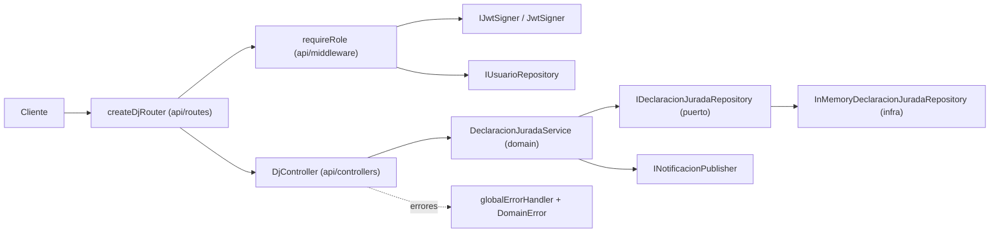
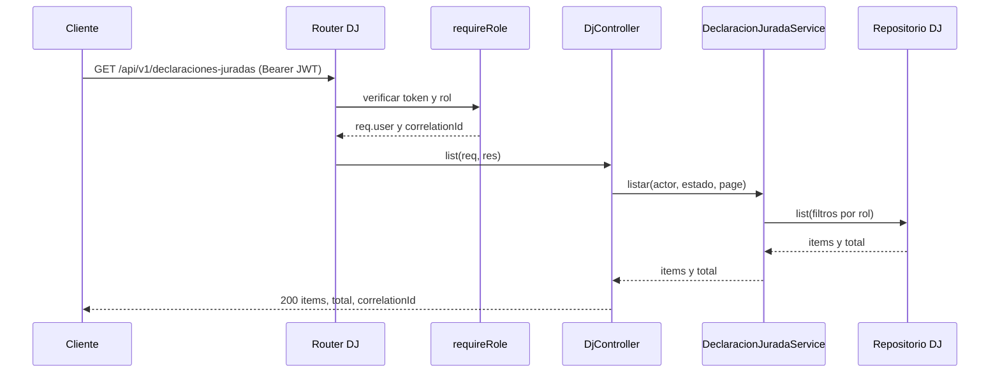
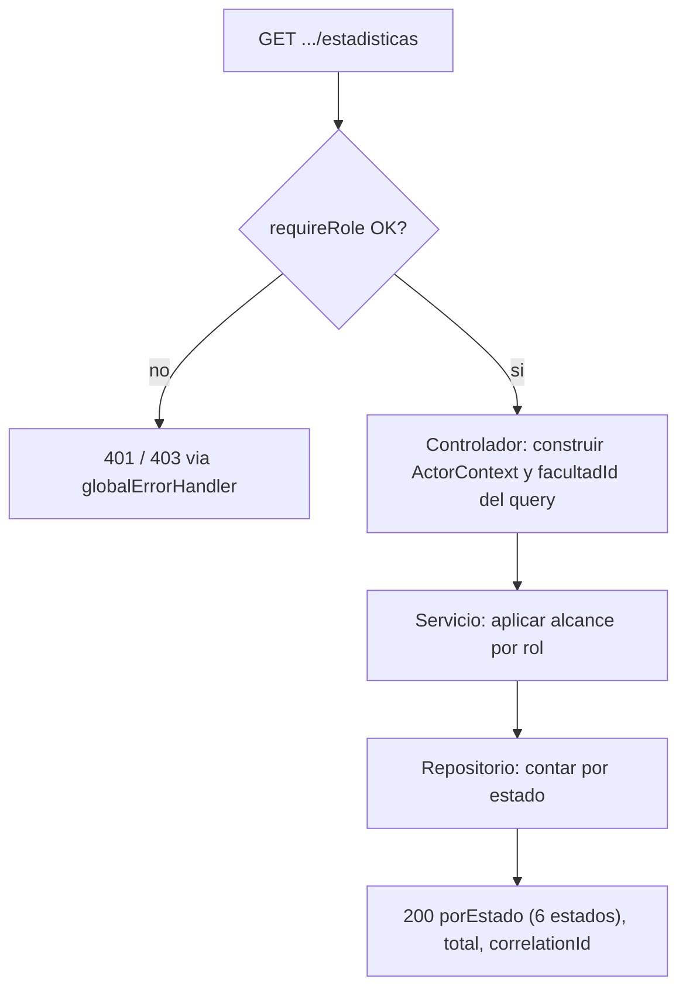

# Architecture

## Architecture Analysis

### System Overview

API REST monolítica en Node 20 / Express 4 con TypeScript ESM, organizada en tres capas hexagonales dentro de `backend/`: `api/` (adaptadores HTTP), `domain/` (servicios, entidades, puertos) e `infrastructure/` (adaptadores de salida: persistencia en memoria o JSON, JWT, clientes de IA, MCP). La persistencia de DJ es en memoria con datos semilla; no hay base de datos.

### Architectural Style

Monolito hexagonal (puertos y adaptadores). Evidencia: puertos `ports/out/I*.ts` en cada dominio, implementaciones en `infrastructure/`, e inyección manual por constructor en `backend/api/app.ts` (raíz de composición).

### Component Relationships

Texto de respaldo: el cliente llama al router de DJ; este aplica `requireRole` (JWT + usuario) y delega en `DjController`, que invoca `DeclaracionJuradaService`; el servicio usa el puerto `IDeclaracionJuradaRepository`, implementado por `InMemoryDeclaracionJuradaRepository`, y el publicador de notificaciones. Los errores terminan en `globalErrorHandler`.

### Data Flow

Request HTTP, `requireRole` fija `req.user` (`userId`, `rol`, `facultadId`, `vinculacionActiva`) y `req.correlationId`, el controlador arma un `ActorContext`, el servicio aplica reglas de alcance por rol y consulta el repositorio, el controlador serializa y responde JSON con `correlationId`. Los `DomainError` se traducen a `{ error, message, correlationId }` con su `httpStatus`.

### Key Design Decisions

- Autorización en dos niveles: la ruta solo exige estar autenticado con un rol permitido; el alcance fino (dueño, facultad) vive en el servicio (`dj.routes.ts:12-16`).
- `asyncHandler` reenvía rechazos de promesas a `next` (Express 4).
- Errores de dominio con catálogo cerrado de códigos y mensajes en es-BO (`DomainError.ts`).
- `requireRole` es fail-closed respecto de `vinculacionActiva`.
- `app.ts` exporta `app` pero también carga `.env` y crea todo el grafo; las pruebas HTTP montan routers propios.

### Improvement Opportunities

- `listar` es fail-open para `ADMIN_FACULTAD` sin `facultadId` (`DeclaracionJuradaService.ts:60`).
- Sin método de conteo/agregación en el puerto del repositorio.
- Sin linter ni CI en `backend/`.

## Interaction Diagrams

### Listado de DJ con alcance por rol (flujo existente, base para estadísticas)

Texto de respaldo: el cliente envía el JWT; `requireRole` valida y fija el usuario; el controlador llama a `listar` con el actor; el servicio añade `docenteId` (DOCENTE) o `facultadId` (ADMIN_FACULTAD) al filtro y el repositorio devuelve la página; el controlador responde 200. Un token ausente o inválido produce 401 y un rol no permitido 403 mediante `globalErrorHandler`.

### Punto de extensión para estadísticas

Texto de respaldo: tras la autenticación, el controlador pasa el actor y el `facultadId` opcional al servicio, que decide el alcance, consulta el repositorio y devuelve los seis estados con conteo (0 si no hay). La ruta debe declararse antes de `/:id`.
