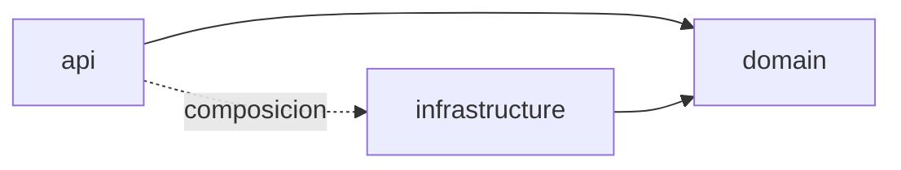

# Dependencies

## Dependencias externas
Ver versiones en `technology-stack.md`. Runtime del backend: express, zod, jsonwebtoken, bcryptjs, cors, express-rate-limit, @modelcontextprotocol/sdk. Desarrollo: typescript, tsx y tipos de express, cors, bcryptjs, jsonwebtoken. Las dependencias de prueba (jest, ts-jest, supertest, ajv) están en el `package.json` de la raíz, no en `backend/package.json`.

## Dependencias internas (dirección de capas)

Texto de respaldo: `api` y `infrastructure` dependen de `domain`; `domain` no importa de ellas (salvo tipos propios). Solo `api/app.ts` conoce las implementaciones de infraestructura.

## Cadena relevante para la intención

- `dj.routes.ts` depende de `dj.controller.ts`, `auth.middleware.ts`, `asyncHandler.ts`, `dj.validator.ts` y `Rol`.
- `dj.controller.ts` depende de `DeclaracionJuradaService`, `EstadoDJ`, `ComandoDJ`.
- `DeclaracionJuradaService` depende de `IDeclaracionJuradaRepository`, `INotificacionPublisher`, `DJStateMachine`, `Rol`, `DomainError`.
- `InMemoryDeclaracionJuradaRepository` implementa el puerto; `DjMcpServer` y el orquestador también consumen `DeclaracionJuradaService.listar`, por lo que cambiar su firma tiene impacto en ellos.

## Observaciones
- Las pruebas y el motor de ejecución dependen de la raíz del repo (`jest.config.cjs`, `tsconfig` de `backend/`).
- `tsconfig.json` referencia `../demo/dj-core/**/*`, fuera de `backend/`.
