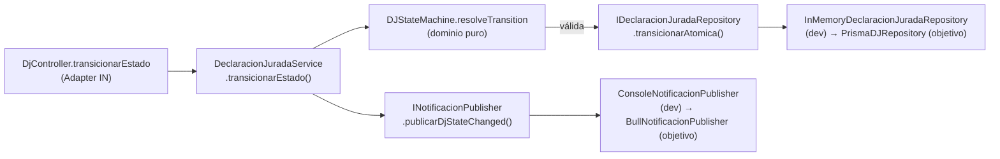

# Design Doc `DD-UC-001` — Ciclo Completo de Declaración Jurada (M-DJ)

> **Qué es**: documento de diseño del feature que implementa `FSD-UC-002`. Describe el **cómo** de lo ya construido en `backend/domain/declaracion-jurada/`, `backend/api/` y los adaptadores in-memory/console usados durante el desarrollo, con trazabilidad explícita al FSD vivo y al DTI vFinal.
>
> **Relación con otros documentos**: complementa (no reemplaza) al ADR — en este caso no se requiere ninguno nuevo (§3). Alimenta `docs/product/DTP.md` §A.1/§A.3.

## 1. Objetivo y contexto

- **Qué resuelve este feature**: permite al docente crear, editar y enviar una Declaración Jurada (DJ), y a Admin. de Facultad / Técnico DPA revisarla, aprobarla, devolverla, escalarla o rechazarla, con historial de auditoría atómico y notificación al actor correspondiente en cada transición.
- **Caso(s) de uso del FSD que implementa**: `FSD-UC-002` — Ciclo Completo de Declaración Jurada, enlace: `docs/product/FSD.md` (UC-L-01) y `docs/baseline/FSD.md` §4.2 (versión congelada, con el aviso-contrato `PR-FSD-UC-002`).
- **Alcance**:
  - **Dentro**: máquina de estados de la DJ (RB-01, RB-03), persistencia atómica de estado + historial (RB-06), notificación post-commit, endpoints REST (`/declaraciones-juradas`), pantallas React del docente y del Admin. de Facultad.
  - **Fuera**: autenticación real JWT+LDAP (FSD-UC-001, hoy cubierta por `demoAuthMiddleware` como stand-in), persistencia PostgreSQL/Prisma real, cola Bull/Redis real (ver §4), generación de reportes (FSD-UC-007).

## 2. Diseño (el "cómo") `[humano+máquina]`

- **Enfoque elegido**: arquitectura hexagonal fiel al DTI vFinal §5 — dominio puro (sin Express/Prisma/Bull), con una máquina de estados de transición explícita como tabla de reglas (`REGLAS: TransitionRule[]`) en vez de un motor FSM genérico o librería externa (p. ej. `xstate`). Esto mantiene el invariante `domain/` sin dependencias externas (DTI §5.3, ADR-0001) y hace cada regla auditable en una tabla legible.
- **Componentes tocados** (capas hexagonales):
  - **Dominio** (`backend/domain/declaracion-jurada/`):
    - `entities/DeclaracionJurada.ts` — agregado, sin dependencias de infraestructura.
    - `services/DJStateMachine.ts` — resuelve transiciones puras (`resolveTransition`, `assertCamposEditables`) contra la tabla `REGLAS`; valida rol, misma facultad (RB-05 aplicado también aquí para ADMIN_FACULTAD), vinculación activa (RB-01) y observaciones obligatorias en DEVOLVER/RECHAZAR.
    - `services/DeclaracionJuradaService.ts` — orquesta: `crear`, `listar`, `obtenerDetalle`, `actualizarCampos` (RB-03 vía `assertCamposEditables`), `transicionarEstado` (delega la resolución al FSM, persiste vía el puerto, encola notificación post-commit sin bloquear la respuesta si falla).
    - `types/{ComandoDJ,EstadoDJ,CrearDJ,TransicionDJ}.ts` — enums y DTOs del dominio.
    - `ports/out/{IDeclaracionJuradaRepository,INotificacionPublisher}.ts` — puertos de salida, idénticos en forma a los definidos en el DTI §5.1.
  - **Adaptadores IN** (`backend/api/`): `controllers/dj.controller.ts`, `routes/dj.routes.ts`, `validators/dj.validator.ts` (Zod), `middleware/auth.middleware.ts` (`demoAuthMiddleware` + `globalErrorHandler` que traduce `DomainError` a HTTP).
  - **Adaptadores OUT — desarrollo** (`backend/infrastructure/`): `persistence/InMemoryDeclaracionJuradaRepository.ts`, `notifications/ConsoleNotificacionPublisher.ts`.
  - **Frontend** (`frontend/src/pages/declaraciones-juradas/`): listado, detalle, formulario de creación, panel de acciones y badge de estado — consumen los mismos DTOs del contrato API.
- **Contratos y tipos**:
  - `TransicionDJCommand` → `{ djId, comando, actorId, actorRol, actorFacultadId?, observaciones? }` (coincide con DTI §4.3).
  - `TransicionDJResult` → `{ djId, estadoAnterior, estadoNuevo, historialId, notificacionEncolada }`.
  - Errores tipados: `ForbiddenError` (403: `INACTIVE_BINDING`, `FORBIDDEN_TRANSITION`), `NotFoundError` (404: `DJ_NOT_FOUND`), `ValidationError` (422: `INVALID_STATE_TRANSITION`, `OBSERVATIONS_REQUIRED`) — mensajes en `USER_MESSAGES_ES_BO`, sin PII.
  - Endpoints: `GET/POST /declaraciones-juradas`, `GET /:id`, `PATCH /:id` (campos), `PATCH /:id/estado` (transición) — DTI §5.2 `DJRestController`.
- **Diagrama** (flujo de una transición):

## 3. Alternativas consideradas

| Alternativa | Pros | Contras | ¿Elegida? |
|-------------|------|---------|-----------|
| A. Tabla de reglas de transición (`REGLAS: TransitionRule[]`) evaluada en dominio puro | Cero dependencias en `domain/` (cumple ADR-0001); reglas auditables en una sola tabla; testeable sin I/O | Menos expresiva que un motor FSM genérico para máquinas muy grandes | sí |
| B. Librería FSM genérica (p. ej. `xstate`) en el dominio | Herramientas de visualización, guards declarativos | Introduce dependencia externa en `domain/`, viola el invariante hexagonal del DTI §5.3 sin justificación de negocio | no |
| C. Validación de transición en la capa API/controller | Menos código en dominio | Rompe la regla de oro "reglas de negocio en el dominio, no en la UI/API" (DTI §1); no reutilizable desde otros adaptadores IN | no |

> No hay alternativa aquí que sea significativa o costosa de revertir respecto de lo ya decidido en el DTI vFinal (arquitectura hexagonal, ADR-0001) — **no se crea ADR nuevo**. El único punto potencialmente "divergente" — usar adaptadores in-memory/console en vez de Prisma/Bull — no es una decisión de diseño sino un estado de implementación pendiente (§4), reversible sin tocar el dominio porque ambos ya implementan los puertos definidos en el DTI.

## 4. Impacto en las specs vivas `[máquina]`

| Artefacto vivo | Cambio | ¿Delta vs DTI vFinal? |
|----------------|--------|-----------------------|
| `docs/product/FSD.md` (M-DJ, UC-L-01) | Estado del módulo actualizado de 🔴 Pendiente a 🟡 En progreso; se enlaza `DD-UC-001` | no |
| `docs/product/PRD.md` | Sin cambio de contenido (copia viva del baseline) | no |
| `docs/product/DTP.md` | §A.1 changelog (creación de `DD-UC-001` + `PR-IMPL-001/002`), §A.3 estado `FSD-UC-002 = en curso` | no |

> **Recordatorio (regla de oro)**: el baseline congelado de M4 (`docs/baseline/`) **no se toca**. Los cambios de este feature viven en `docs/product/` y en este mismo design doc.

**Pendiente de implementación (no es un delta, es trabajo restante ya previsto en el DTI):**
- `PrismaDJRepository` (DTI §5.2) para reemplazar `InMemoryDeclaracionJuradaRepository` — mismo puerto `IDeclaracionJuradaRepository`, transacción `$transaction([UPDATE estado, INSERT historial])` (RB-06) tal como especifica el DTI §5.2 y §7.
- `BullNotificacionPublisher` (DTI §5.2, §7) para reemplazar `ConsoleNotificacionPublisher` — mismo puerto `INotificacionPublisher`, evento `DJ_STATE_CHANGED` (DTI §7.1).
- Autenticación real JWT + LDAP (FSD-UC-001) para reemplazar `demoAuthMiddleware`.

Si al implementar cualquiera de estos tres puntos aparece una razón para apartarse de lo que dice el DTI vFinal (p. ej. cambiar el modelo de idempotencia de notificaciones), **eso sí exige actualizar `docs/product/DTP.md` §A.2 y crear un ADR antes de codear**.

## 5. Prompts usados `[máquina]`

| Prompt | Tarea | Artefacto generado |
|--------|-------|--------------------|
| `PR-IMPL-001` | Dominio: entidad, tipos, `DJStateMachine`, `DeclaracionJuradaService`, puertos + tests unitarios | `backend/domain/declaracion-jurada/**`, `backend/domain/shared/errors/DomainError.ts` |
| `PR-IMPL-002` | Adaptadores: API REST (controller/routes/validators/middleware demo) + adaptadores de desarrollo (in-memory, console) | `backend/api/**`, `backend/infrastructure/persistence/InMemoryDeclaracionJuradaRepository.ts`, `backend/infrastructure/notifications/ConsoleNotificacionPublisher.ts` |

> Cada prompt vive en `docs/prompts/impl/PR-IMPL-NNN.md` y se referencia desde `docs/PROMPT_MAPPING.md`.

## 6. Plan de pruebas y evals

- **Unit**: `backend/domain/declaracion-jurada/services/DJStateMachine.test.ts` — cubre RB-01 (rechazo sin vinculación activa), transición válida BORRADOR→EN_REVISION_FACULTAD, rechazo desde estado terminal (APROBADA), rechazo de edición de campos en estado no editable (RB-03). Pendiente: casos de DEVOLVER/RECHAZAR sin observaciones (`OBSERVATIONS_REQUIRED`) y cruce de facultad (RB-05 aplicado a ADMIN_FACULTAD).
- **Integration**: pendiente — Supertest sobre `createDjRouter` con `InMemoryDeclaracionJuradaRepository`; al migrar a Prisma, repetir contra Postgres efímero (Testcontainers o Docker Compose de test).
- **E2E / Gherkin**: deriva de los criterios de aceptación de `FSD-UC-002` (`docs/baseline/FSD.md` §4.2): envío de DJ → notificación < 60 s, intento de editar DJ `APROBADA` → HTTP 403 + auditoría. Pendiente automatizar con Playwright.
- **Evals de IA**: no aplica — el SGAI no tiene agentes en runtime (DTI §9.1); la evaluación de IA es solo de proceso (PROMPT_MAPPING).

## 7. Definition of Done (checklist)

- [x] `fsd_uc` declarado y enlazado (trazabilidad al FSD).
- [x] Diseño (§2) y alternativas (§3) documentados.
- [x] ADR creado/enlazado si hubo decisión significativa → **no aplica, justificado en §3**.
- [x] §4 Impacto en specs vivas registrado (sin tocar el baseline).
- [x] Prompt(s) versionado(s) en `docs/prompts/impl/` y en `PROMPT_MAPPING.md`.
- [ ] Tests/evals definidos y pasando → unit tests existentes parciales (§6); integración y E2E pendientes.
- [ ] DTP actualizado (changelog + estado del FSD-UC) → hecho en esta sesión, requiere `@dtp-sync` en el próximo PR de código real.
- [ ] PR declara: prompts usados, archivos generados vs editados a mano → pendiente del próximo PR (persistencia Prisma/Bull).
