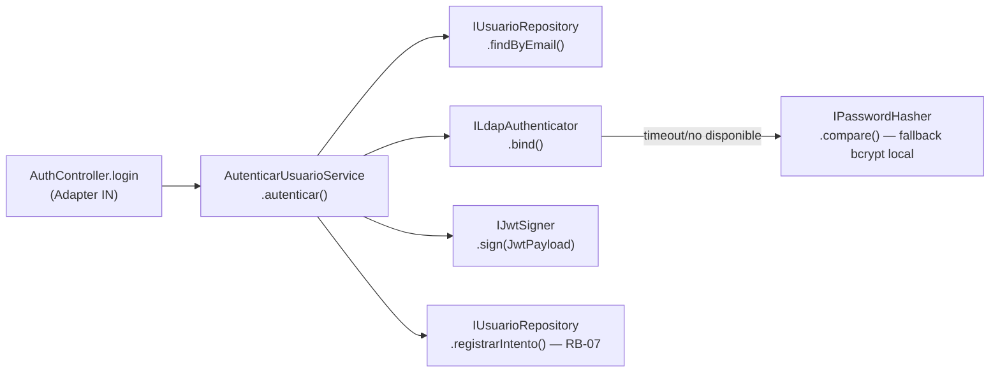

# Design Doc `DD-UC-002` — Autenticación y Control de Acceso por Roles (M-AUTH)

> **Qué es**: diseño del feature que implementa `FSD-UC-001`. Este documento nació **prescriptivo** (sin código, solo existía `demoAuthMiddleware`) y ya fue ejecutado vía `PR-IMPL-003`/`PR-IMPL-004`: hoy el dominio, los adaptadores bcrypt/JWT reales y el endpoint `POST /api/v1/auth/login` existen y fueron probados end-to-end (login de los 4 roles + bloqueo RB-07 verificado manualmente). Sigue pendiente la integración LDAP real y `PrismaUsuarioRepository` (§4).
>
> **Relación con otros documentos**: complementa al ADR — no se requiere ninguno nuevo (§3). Alimenta `docs/product/DTP.md` §A.1/§A.3.
>
> **Nota de implementación**: `PR-IMPL-004` usó `bcryptjs` en vez de `bcrypt` (mismo algoritmo, cost factor 12, sin bindings nativos) — sustitución de librería, no un delta arquitectónico.

## 1. Objetivo y contexto

- **Qué resuelve este feature**: permite a cualquier usuario (Docente, Admin. Facultad, Técnico DPA, Admin. Sistema) autenticarse con sus credenciales institucionales, recibir un JWT con su rol y facultad, y que el sistema controle el acceso a cada endpoint según ese rol.
- **Caso(s) de uso del FSD que implementa**: `FSD-UC-001` — Autenticación y Control de Acceso por Roles, enlace: `docs/product/FSD.md` (M-AUTH) y `docs/baseline/FSD.md` §4.1 (versión congelada).
- **Alcance**:
  - **Dentro**: login con LDAP institucional + fallback bcrypt local, emisión/verificación de JWT, bloqueo de cuenta tras 5 intentos fallidos (RB-07), middleware `requireRole` para RBAC en endpoints protegidos.
  - **Fuera**: alta/edición de usuarios (`FSD-UC-010`, Admin. Sistema), gestión de roles institucionales por facultad (`FSD-UC-009`), recuperación de contraseña (no especificada en el FSD vigente).

> **Corrección de trazabilidad detectada**: tanto `docs/baseline/FSD.md` §4.1 como `docs/product/FSD.md` citan la regla de bloqueo de cuenta como parte del FSD-UC-001 sin fijar un ID de regla de negocio consistente (el FSD la deja bajo "RB-04", que en el glosario de `AGENTS.md` §3.3 y `docs/product/FSD.md` §5 corresponde a *"Boletas solo docente titular"*, no a login). La regla correcta para "5 intentos fallidos → bloqueo 15 min" es **RB-07** (confirmado en `AGENTS.md` §3.3, `docs/SKILLS/auth-rbac-guard.md` y `docs/baseline/DTI_vFinal.md` §13.2). Este DD usa `RB-07`. **No se edita el baseline** para corregir esto — se deja registrado aquí y en `docs/product/DTP.md` §A.2 como nota, no como delta arquitectónico (es un error de referencia de ID, no una decisión de diseño).

## 2. Diseño (el "cómo") `[humano+máquina]`

- **Enfoque elegido**: siguiendo el DTI vFinal §5.1/§13.2 — LDAP institucional como mecanismo primario de autenticación, con **fallback a bcrypt local** si LDAP no responde en el timeout (5 s, DTI §7.2). El dominio no conoce `jsonwebtoken`, `bcrypt` ni `ldapjs`: expone puertos (`IPasswordHasher`, `IJwtSigner`, `ILdapAuthenticator`) que la infraestructura implementa, igual que en `DD-UC-001` con `IDeclaracionJuradaRepository`.
- **Componentes tocados** (capas hexagonales):
  - **Dominio** (`backend/domain/administracion/`):
    - `entities/Usuario.ts` — agregado: `id, email, passwordHashLocal, rol, facultadId, vinculacionActiva, intentosFallidos, bloqueadoHasta`.
    - `types/{LoginCommand,JwtPayload}.ts` — DTOs ya definidos en DTI §4.3 (`LoginCommand { email, password, ip }`, `JwtPayload { userId, email, rol, facultadId, iat, exp }`).
    - `services/AutenticarUsuarioService.ts` — orquesta: verificar `bloqueadoHasta`, intentar LDAP (con timeout), si LDAP no disponible → comparar `passwordHashLocal` vía `IPasswordHasher`, resetear/incrementar `intentosFallidos`, bloquear 15 min al 5º intento (RB-07), firmar JWT vía `IJwtSigner` si la autenticación es válida.
    - `ports/in/AutenticarUsuarioUseCase.ts` — puerto de entrada (nombre tal cual DTI §5.1).
    - `ports/out/{IUsuarioRepository,ILdapAuthenticator,IPasswordHasher,IJwtSigner}.ts` — puertos de salida.
  - **Adaptadores IN** (`backend/api/`): `controllers/auth.controller.ts` (`POST /auth/login`), `routes/auth.routes.ts`, `validators/auth.validator.ts` (Zod `LoginSchema`), `middleware/requireRole.ts` (reemplaza a `demoAuthMiddleware` fuera de `dev`), `middleware/authRateLimit.ts` (`express-rate-limit` en `POST /auth/login`, defensa adicional a la de Nginx del DTI §13.1).
  - **Adaptadores OUT**:
    - **Reales desde el inicio** (sin dependencia de infraestructura externa): `BcryptPasswordHasher` (bcrypt cost ≥ 12) y `JwtSigner` (jsonwebtoken, HS256, exp 8 h — NFR-006).
    - **Stand-in de desarrollo** (requiere directorio LDAP institucional que no está disponible en este entorno, igual que `InMemoryDeclaracionJuradaRepository` en `DD-UC-001` sustituye a Postgres): `LdapUnavailableAuthenticator` — implementa `ILdapAuthenticator` devolviendo siempre "no disponible", forzando el fallback a bcrypt local ya previsto por el DTI. `InMemoryUsuarioRepository` con usuarios semilla (uno por rol) para poder probar el flujo sin Postgres.
- **Contratos y tipos**:
  - `LoginCommand` → `{ email, password, ip }` (DTI §4.3).
  - `JwtPayload` → `{ userId, email, rol, facultadId, iat, exp }` (DTI §4.3) — **nunca** incluye `ci` ni datos financieros.
  - Errores tipados nuevos (mismo patrón que `DomainError` de `DD-UC-001`): `UnauthorizedError` (401 `INVALID_CREDENTIALS` — mensaje genérico, RB-07), `ForbiddenError('ACCOUNT_LOCKED')` (403, con `bloqueadoHasta` en el contexto, no en el mensaje al usuario).
  - Endpoint: `POST /auth/login` → `{ token, rol, nombreCompleto, facultadId }` (DTI §5.2, tabla de adaptadores IN).
- **Diagrama** (flujo de login):

> Diagrama de secuencia ya existente en el repo: `docs/DIAGRAMS/seq_uc001_autenticacion.mmd` (referenciarlo, no se recrea aquí).

- **Frontend** (`frontend/src/`) — agregado tras detectar que la SPA no pedía login y entraba directo a `/declaraciones-juradas`:
  - `services/authStore.ts` — sesión en memoria (token, rol, nombreCompleto, facultadId); **MUST NOT** persistir en localStorage/sessionStorage (`docs/SKILLS/auth-rbac-guard.md`) — se pierde al refrescar la página, trade-off aceptado por seguridad.
  - `services/authApi.ts` — `login(email, password)` contra `POST /api/v1/auth/login`.
  - `context/AuthContext.tsx` — reemplaza al antiguo `DemoAuthContext` (selector de rol libre); expone `isAuthenticated`, `rol`, `label`, `nombreCompleto`, `login()`, `logout()`, y `inactiveBinding` (simulación RB-01, independiente de la identidad).
  - `components/RequireAuth.tsx` — guard de rutas; redirige a `/login` si no hay sesión.
  - `pages/login/LoginPage.tsx` — formulario real.
  - `App.tsx` — `/` redirige a `/login` o `/declaraciones-juradas` según `isAuthenticated`; rutas de DJ envueltas en `RequireAuth`.
  - `DjLayout.tsx` / `DJActionPanel.tsx` — usan `useAuth()` en vez de `useDemoAuth()`; "Nueva DJ" solo visible para `DOCENTE`.
  - `declaracionesJuradasApi.ts` — **puente temporal**: como `dj.routes.ts` todavía usa `demoAuthMiddleware` (header, no JWT) y no se tocó en esta ejecución (evitar conflicto con la migración de tipos en curso en paralelo), el header `X-SGAI-Demo-User` se deriva ahora del `rol` ya autenticado por login real, no de un selector libre. Cuando `dj.routes.ts` migre a `requireRole` (JWT real), este puente se elimina y se envía `Authorization: Bearer <token>` en su lugar.

## 3. Alternativas consideradas

| Alternativa | Pros | Contras | ¿Elegida? |
|-------------|------|---------|-----------|
| A. LDAP primario + fallback bcrypt local ante timeout/no disponibilidad | Cumple el DTI §13.2 tal cual; resiliencia ante caída de LDAP (patrón ya definido en DTI §6, tabla de resiliencia) | Requiere mantener dos vías de verificación (LDAP + hash local) | sí |
| B. Solo bcrypt local (sin integración LDAP) | Más simple; sin dependencia de directorio institucional | Contradice el requisito de "credenciales institucionales" (PRD-REQ-001, DTI §13.2); sería un delta y exigiría ADR | no |
| C. Solo LDAP, sin fallback | Una sola fuente de verdad de identidad | Sin resiliencia: una caída de LDAP bloquea el login de 1.500+ docentes; contradice el patrón de resiliencia ya aprobado en DTI §6 | no |

> Ninguna alternativa aquí diverge del DTI vFinal — la opción elegida (A) es exactamente la especificada en DTI §13.2. **No se crea ADR nuevo.** El uso de `LdapUnavailableAuthenticator` como stand-in de desarrollo tampoco es una decisión de diseño: es el mismo patrón de `DD-UC-001` §3 (adaptador de desarrollo detrás de un puerto ya definido, reemplazable sin tocar dominio) aplicado a una dependencia externa (directorio LDAP) que no está disponible en este entorno — el propio DTI ya prevé este camino de fallback.

## 4. Impacto en las specs vivas `[máquina]`

| Artefacto vivo | Cambio | ¿Delta vs DTI vFinal? |
|----------------|--------|-----------------------|
| `docs/product/FSD.md` (M-AUTH) | Enlazar `DD-UC-002`; mantener 🟡 En progreso (bcrypt/JWT reales + LDAP pendiente de directorio institucional) | no |
| `docs/product/PRD.md` | Sin cambio de contenido (copia viva del baseline) | no |
| `docs/product/DTP.md` | §A.1 changelog (creación de `DD-UC-002` + `PR-IMPL-003/004`), §A.2 nota sobre el ID de regla mal referenciado en el FSD (RB-04 → RB-07, no es delta arquitectónico), §A.3 estado `FSD-UC-001 = en curso` | no |

> **Recordatorio (regla de oro)**: el baseline congelado de M4 (`docs/baseline/`) **no se toca** — ni siquiera para corregir la referencia RB-04→RB-07 detectada arriba.

**Pendiente de implementación (no es un delta, es trabajo restante ya previsto en el DTI):**
- Integración real con el directorio LDAP/AD institucional (`LdapAuthAdapter`, DTI §5.2) — bloqueado por acceso/credenciales de la Unidad de TI (mismo tipo de riesgo que `docs/product/FSD.md` §13 ya registra para SMTP).
- `PrismaUsuarioRepository` para reemplazar `InMemoryUsuarioRepository`.
- Reemplazar `demoAuthMiddleware` por el middleware `requireRole` real basado en JWT en `dj.routes.ts` (de `DD-UC-001`) — hasta entonces, el frontend usa el puente descrito en §2 (header demo derivado del rol autenticado).
- Persistencia de sesión más allá de un refresh de página (hoy en memoria) — evaluar httpOnly cookie si se requiere, sin volver a localStorage/sessionStorage.

## 5. Prompts usados `[máquina]`

| Prompt | Tarea | Artefacto generado |
|--------|-------|--------------------|
| `PR-IMPL-003` | Dominio: `Usuario`, `AutenticarUsuarioService`, puertos, políticas RB-07/NFR-006 + tests unitarios | `backend/domain/administracion/**` |
| `PR-IMPL-004` | Adaptadores: bcrypt/JWT reales, LDAP stand-in, `InMemoryUsuarioRepository`, `AuthController`/rutas/rate-limit/`requireRole` | `backend/api/{controllers,routes,validators,middleware}/auth.*`, `backend/infrastructure/auth/**` |

> Cada prompt vive en `docs/prompts/impl/PR-IMPL-NNN.md` y se referencia desde `docs/PROMPT_MAPPING.md`.

## 6. Plan de pruebas y evals

> **Nota sobre el umbral de cobertura**: se pidió cumplir "90 % de cobertura" citando `AGENTS.md`. Verificado: `AGENTS.md` (raíz y `docs/AGENTS/AGENTS.md`) define **NFR-010 = cobertura de dominio ≥ 80 %**, igual que `docs/baseline/DTI_vFinal.md` §11 y §14 (pirámide de testing). No existe ningún 90 % documentado para cobertura de tests (el 90 % que sí aparece en el repo es *Spec Fidelity* del proceso AI-SDLC, una métrica distinta). Este plan usa **80 %** como umbral vinculante de `backend/domain/administracion/`; si se quiere un umbral más estricto específico para el módulo de auth por ser código de seguridad crítico, es una decisión de producto que debería actualizar `NFR-010` en `docs/product/DTP.md` §B antes de exigirse como gate.

- **Unit** (`backend/domain/administracion/services/AutenticarUsuarioService.test.ts`) — **ejecutado**: 8/8 tests pasando (credenciales inválidas con mensaje genérico, uso de LDAP cuando está disponible sin llamar al fallback, bloqueo al 5º intento fallido RB-07, rechazo sin validar password si ya está bloqueada, reset de `intentosFallidos` tras login exitoso, desbloqueo tras expirar los 15 min). **Cobertura real: 100 % statements/branches/funcs/lines de `backend/domain/administracion/`** (`npm run test:domain:auth` desde la raíz), muy por encima del umbral NFR-010 (≥ 80 %).
- **Manual E2E** (con el servidor real, `npm run dev:api`): verificado `POST /api/v1/auth/login` para los 4 roles semilla (`Demo1234!`), verificado bloqueo tras el 5º intento fallido con `admin.facultad@universidad.edu.bo` (5º intento → `INVALID_CREDENTIALS`, 6º en adelante → `ACCOUNT_LOCKED` 403 incluso con password correcto).
- **Integration (Supertest)**: **pendiente** — no se escribió en esta ejecución; recomendado antes de dar la feature por completamente cerrada.
- **E2E automatizado (Playwright)**: pendiente, mismos criterios Gherkin de `FSD-UC-001`.
- **Evals de IA**: no aplica (SGAI sin agentes en runtime, DTI §9.1).

## 7. Definition of Done (checklist)

- [x] `fsd_uc` declarado y enlazado (trazabilidad al FSD).
- [x] Diseño (§2) y alternativas (§3) documentados.
- [x] ADR creado/enlazado si hubo decisión significativa → **no aplica, justificado en §3**.
- [x] §4 Impacto en specs vivas registrado (sin tocar el baseline).
- [x] Prompt(s) versionado(s) en `docs/prompts/impl/` y en `PROMPT_MAPPING.md`.
- [x] Tests/evals definidos y pasando → 8/8 unit tests, 100 % cobertura del módulo (NFR-010 ≥ 80 % cumplido). Integración/E2E automatizado quedan pendientes (ver §6).
- [x] DTP actualizado (changelog + estado del FSD-UC) → hecho en esta sesión.
- [x] PR declara: prompts usados, archivos generados vs editados a mano → todo el código de `PR-IMPL-003`/`PR-IMPL-004` fue generado por los prompts, sin edición manual adicional más allá de las correcciones de tipado descritas en el changelog del DTP.
