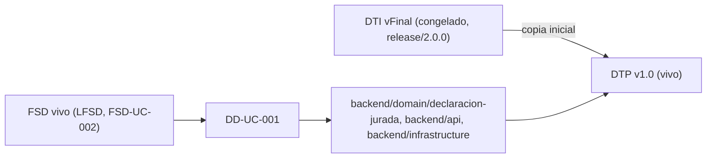

# Documento Técnico del Producto (DTP) — SGAI

> **Qué es**: el DTP es la **continuación viva del DTI**. Donde el DTI fue *"el plano"* (foto técnica congelada al cierre de M4, `release/2.0.0`), el DTP es *"el DTI que compila"*: el **contrato técnico vigente** del producto mientras se implementa.
>
> **Regla de oro**: **cero divergencia silenciosa**. Si el código necesita contradecir una decisión del DTI vFinal, primero se actualiza el ADR + el DTP + la spec viva; **nunca al revés**.
>
> **Qué NO es**: el DTP **no reescribe** el baseline congelado (`docs/baseline/`). El baseline permanece intacto y recuperable en el tag `release/2.0.0`.

## Cómo se originó

1. Se copió el **DTI vFinal** (`docs/baseline/DTI_vFinal.md`, commit `207719b`) como punto de partida (`status: vivo`).
2. A partir de aquí, todo cambio técnico entra por el flujo de control de cambios (§A).
3. El baseline de M4 queda inmutable en `docs/baseline/` + tag `release/2.0.0`.

---

## A. Control de cambios (núcleo del DTP) `[humano+máquina]`

### A.1 Changelog de implementación

| Fecha | Cambio | Disparador (FSD-UC / DD / hallazgo) | ADR | PR / commit | Autor |
|-------|--------|-------------------------------------|-----|--------------|-------|
| 06/07/2026 | Migración documental: baseline movido a `docs/baseline/`, capa viva creada en `docs/product/` (PRD, FSD, DTP) | Modelo documental de implementación | — | (pendiente commit) | Carolina Aguilar |
| 06/07/2026 | Creado `DD-UC-001` para FSD-UC-002 (Ciclo Completo de DJ), documentando el dominio + API ya implementados en `backend/` | FSD-UC-002 / DD-UC-001 | — | (pendiente commit) | Carolina Aguilar |
| 06/07/2026 | Versionados `PR-IMPL-001` y `PR-IMPL-002` en `docs/prompts/impl/`, registrados en `PROMPT_MAPPING.md` | DD-UC-001 | — | (pendiente commit) | Carolina Aguilar |
| 06/07/2026 | Creado `DD-UC-002` para FSD-UC-001 (Autenticación y RBAC) — diseño prescriptivo, sin código todavía | FSD-UC-001 / DD-UC-002 | — | (pendiente commit) | Carolina Aguilar |
| 06/07/2026 | Versionados `PR-IMPL-003` y `PR-IMPL-004` en `docs/prompts/impl/`, registrados en `PROMPT_MAPPING.md` | DD-UC-002 | — | (pendiente commit) | Carolina Aguilar |
| 06/07/2026 | Ejecutados `PR-IMPL-003`/`004`: dominio + adaptadores de M-AUTH (JWT/bcrypt reales, LDAP stand-in), endpoint `POST /api/v1/auth/login`, 8 tests unitarios (100% cobertura), verificado end-to-end (4 roles + bloqueo RB-07) | FSD-UC-001 / DD-UC-002 | — | (pendiente commit) | Carolina Aguilar |
| 06/07/2026 | Detectado que la SPA no pedía login (entraba directo a `/declaraciones-juradas`); se agregó login real en frontend (`AuthContext`, `LoginPage`, `RequireAuth`) reemplazando el selector de rol demo, con puente temporal de header hacia `dj.routes.ts` (sigue en `demoAuthMiddleware`) | FSD-UC-001 / DD-UC-002 | — | (pendiente commit) | Carolina Aguilar |

### A.2 Deltas respecto al DTI vFinal

> Diferencias **deliberadas** entre lo diseñado en M4 y lo construido. Cada delta significativo exige un ADR.

| # | Sección del DTI afectada | Qué decía el DTI vFinal | Qué dice ahora el DTP | Motivo | ADR |
|---|--------------------------|-------------------------|-----------------------|--------|-----|
| — | — | — | — | Sin deltas de diseño detectados a la fecha. Los adaptadores in-memory/console de M-DJ (ver DD-UC-001 §4) **no** son un delta arquitectónico: implementan los mismos puertos (`IDeclaracionJuradaRepository`, `INotificacionPublisher`) definidos en el DTI §5.1 y son reemplazables sin tocar dominio (hexagonal, ADR-0001). Se listan como pendiente de implementación en §A.3, no como decisión divergente. | — |
| — | `docs/baseline/FSD.md` §4.1 (no editable) | Cita "RB-04" como la regla de bloqueo de cuenta tras 5 intentos fallidos | `DD-UC-002` §1 usa `RB-07` (consistente con `AGENTS.md` §3.3 y `docs/SKILLS/auth-rbac-guard.md`) | Error de referencia de ID en el FSD congelado, no una decisión de diseño — se documenta aquí en vez de editar el baseline | — |

### A.3 Estado de implementación por FSD-UC

| FSD-UC | Design Doc | Estado | Release | Tests/Evals | Notas |
|--------|------------|--------|---------|-------------|-------|
| `FSD-UC-002` | `DD-UC-001` | en curso | `release/3.0.0` | `backend/domain/declaracion-jurada/services/DJStateMachine.test.ts` | Dominio + API + frontend listos con adaptadores in-memory/console; falta `PrismaDJRepository` y `BullNotificacionPublisher` (RB-06 ya cubierto por `transicionarAtomica`) |
| `FSD-UC-001` | `DD-UC-002` | en curso | `release/3.0.0` | `backend/domain/administracion/services/AutenticarUsuarioService.test.ts` (100% cobertura) | Dominio + API listos: JWT/bcrypt reales, LDAP stand-in (`LdapUnavailableAuthenticator`), 4 usuarios semilla. Verificado end-to-end (login + bloqueo RB-07). Falta: LDAP real, `PrismaUsuarioRepository`, migrar `dj.routes.ts` de `demoAuthMiddleware` a `requireRole`, tests de integración Supertest |
| `FSD-UC-003` a `FSD-UC-010` | — | pendiente | `release/3.0.0` | — | Sin Design Doc todavía |

### A.4 Trazabilidad código ↔ DTP

> Cadena completa por feature. Debe poder reconstruirse para cualquier línea del producto.

`BRD/MRD (docs/baseline/)` → `PRD/FSD vivo (FSD-UC-002, docs/product/)` → `Design Doc (DD-UC-001, docs/design/)` → `Prompt (PR-IMPL-001, PR-IMPL-002, docs/prompts/impl/)` → `backend/domain/declaracion-jurada/*, backend/api/{controllers,routes,validators}/dj.*, backend/infrastructure/persistence/InMemoryDeclaracionJuradaRepository.ts, backend/infrastructure/notifications/ConsoleNotificacionPublisher.ts` → `DJStateMachine.test.ts` → (sin ADR — ver §A.2) → **este DTP**.

---

## B. Contenido técnico vigente `[humano+máquina]`

> El DTP mantiene al día las mismas secciones que el DTI. Para cada sección, si **no cambió** respecto al DTI vFinal, se referencia; si **cambió**, se reescribe aquí y se registra el delta en §A.2.

| Sección (espejo del DTI) | ¿Cambió vs DTI vFinal? | Dónde está la versión vigente |
|--------------------------|------------------------|-------------------------------|
| §1 Visión del producto | no | `docs/baseline/DTI_vFinal.md` §1 |
| §2 Contexto del sistema (C4 N1) | no | `docs/baseline/DTI_vFinal.md` §2 |
| §3 Arquitectura de alto nivel (C4 N2/N3) | no | `docs/baseline/DTI_vFinal.md` §3 |
| §3.4 Data flow FSD-UC-002 | no (implementado tal cual) | `docs/baseline/DTI_vFinal.md` §3.4 · detalle de código en `DD-UC-001` §2 |
| §4 Modelo de dominio | no | `docs/baseline/DTI_vFinal.md` §4 |
| §5 Arquitectura hexagonal del core | no | `docs/baseline/DTI_vFinal.md` §5 · confirmado en código (`DD-UC-001` §2) |
| §6–§9 | no | `docs/baseline/DTI_vFinal.md` |
| §10 Prompt mapping | sí (crece con PR-IMPL-*) | `docs/PROMPT_MAPPING.md` |
| §11 NFRs | no | `docs/baseline/DTI_vFinal.md` §11 |
| §12 POCs | no | `docs/baseline/DTI_vFinal.md` §12 |
| §13–§16 | no | `docs/baseline/DTI_vFinal.md` |
| §21 ADRs | sin cambios (0001–0006 vigentes) | `docs/ADR/` |
| §22–§23 Auditoría IA / Evals | sí (crece) | `docs/PROMPT_MAPPING.md`, este DTP §A |

---

## Checklist del DTP

- [x] Frontmatter con `baseline_ref` (DTI vFinal + tag `release/2.0.0`) y `status: vivo`.
- [x] §A.1 Changelog de implementación poblado y al día.
- [x] §A.2 Deltas vs DTI vFinal (ninguno detectado; justificado).
- [x] §A.3 Estado por FSD-UC con su Design Doc.
- [x] §A.4 Trazabilidad código ↔ DTP reconstruible para FSD-UC-002.
- [x] §B: solo secciones cambiadas reescritas; el resto referencia al DTI vFinal.
- [x] `docs/PROMPT_MAPPING.md` ampliado con `PR-IMPL-001`, `PR-IMPL-002` (§4).
- [x] `AGENTS.md` (raíz y `docs/AGENTS/AGENTS.md`) sincronizado con rutas `docs/baseline/` y `docs/product/` + regla de protección §0.2.
- [x] Baseline congelado (`docs/baseline/`) **intacto** (sin ediciones de contenido, solo `git mv` + frontmatter).
